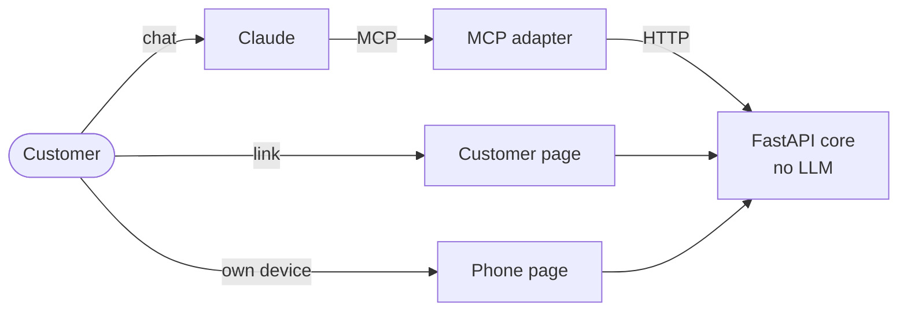
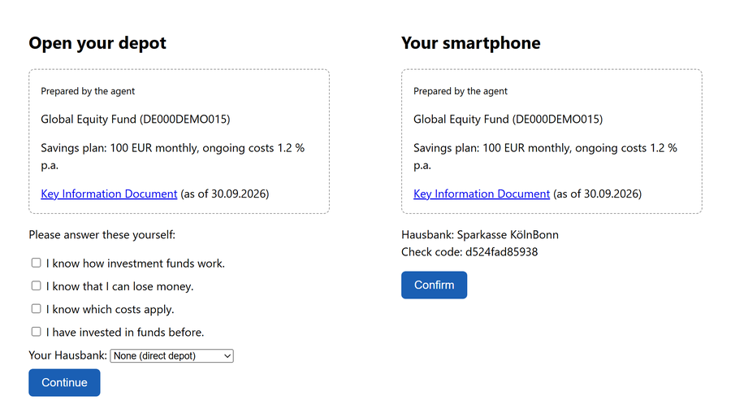

# agent_onboarding

[](https://github.com/karlozizic/agent_onboarding/actions/workflows/tests.yml)

An AI agent (Claude via MCP) prepares a securities account with a fund savings plan. The customer identifies and confirms the offer on their own phone.

**The agent prepares, the customer decides.**



## Guardrails

| Guardrail | Test |
|---|---|
| The agent has no tool to answer questions or confirm | `test_s3_agent_has_no_tool_to_confirm_or_answer` |
| The phone confirms a hash of the offer; any change voids it | `test_s5_phone_cannot_confirm_an_old_offer` |
| Only the customer's phone can confirm | `test_s8_confirm_without_the_phone_is_blocked` |
| Retries with the same idempotency key return the same application | `test_same_key_returns_same_application` |
| Changes need the current version | `test_stale_version_is_rejected` |
| Advice requests go to a human | `test_s7_advice_and_person_are_handed_over` |



## Run

```
uv sync
uv run uvicorn agent_onboarding.core.app:app --port 8000
uv run pytest -q
```

Add to `claude_desktop_config.json` and restart Claude Desktop:

```json
{
  "mcpServers": {
    "account-onboarding": {
      "command": "<repo>\\.venv\\Scripts\\python.exe",
      "args": ["-m", "agent_onboarding.mcp_adapter.server"],
      "env": { "CORE_URL": "http://127.0.0.1:8000", "CORE_TOKEN": "dev-token" }
    }
  }
}
```

Ask Claude to open an account, follow the link it returns, then confirm at `http://127.0.0.1:8000/device?key=phone-demo-key`.

Data is kept in memory and eID is mocked.
